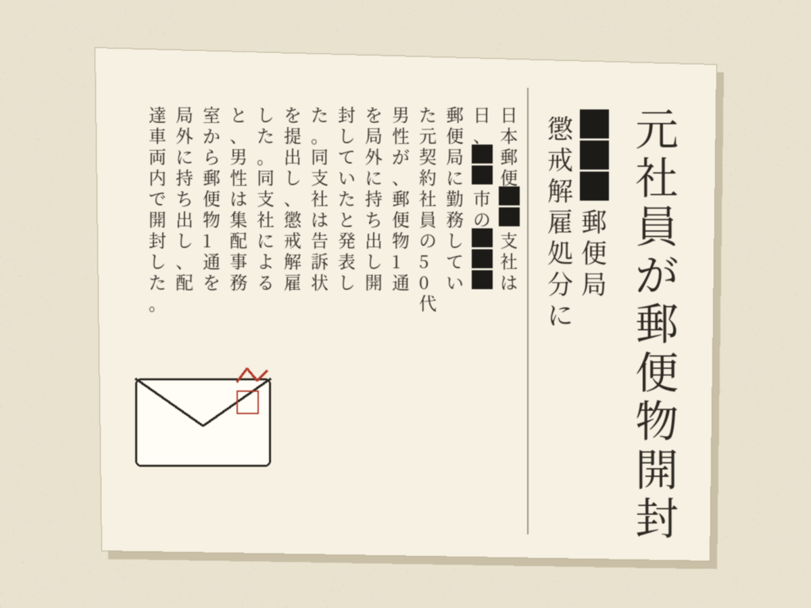

# 郵便物を開けて現金を取ろうとした元同業者のニュースを読んで

## 昨日の新聞に載っていた記事

昨日の新聞に、ある郵便局の元契約社員が郵便物を開封して懲戒解雇になったという記事が載っていました。

50代の男性が集配の事務室から郵便物を1通、局の外へ持ち出して、配達車両の中で開けたそうです。同じ日にほかの社員が郵便物がなくなっていることに気付き、社内調査で発覚したとのことです。本人は、中に現金が入っていたら自分のものにしようと考えていたと話しているそうです。会社は警察に告訴状を出し、懲戒解雇にしています。

## あまりにも短絡的だと思います

どういう雇用形態で、どういうバックグラウンドがある方なのかは分かりません。それでも、あまりにも短絡的な行動だと思います。絶対に捕まると思いますし。

ただ、もしかしたら今まではうまくいっていたのかもしれません。

働いてお給料をもらっているのに、おかしいですよね。封筒に入っているお金なんて小銭程度で、微々たるものだと思います。なぜそういうことになったのでしょうか。本人は平気だったのでしょうか。

## 同じ業界にいる人間として

正直に言うと、郵便の業界には変わった人が多いなということを、自分もその中にいながら感じていました。今回の記事を読んで、やっぱりそうなんだなという現実を突きつけられた気がします。

言葉を選ばずに言えば、もしかしたら境界知能のような方だったのかもしれません。今はそうした括りや枠組みも広く知られるようになってきました。ただ、50代ということは、これまでずっと社会の中で生きてこられたはずです。それがどこかのフィルターにかかることもなく、そのままここまで来てしまったのではないか。周りの人たちがこの人をどう見ていたのかも、この報道だけでは分かりません。

昔、「郵便局は誰でも働ける場所だ」というような、昭和の言葉を聞いたことがあります。これは私の記憶レベルの話ですが、そう考えると、郵便の仕事はそういう人たちの受け口になっている、社会の受け皿のような職種なのかなと少し感じました。

同じ職種にいる人間として、もちろん残念に思いますし、その気持ちは私には分かりません。

## もっと違う方法があったのではないか

人のものを取るのではなく、もっと自分の身になるような方法でお金を稼ぐこともできたはずです。たとえば単発のアルバイトをするとか、そういう選択肢もあったのではないかと思います。

単純にお金が欲しかっただけなのかもしれません。この報道だけでは、なんとも分かりませんね。

## 報道のあり方は昔から変わらない

この記事は、業界そのものが悪いという印象だけを与える報道でもあると感じました。詳細が分からないだけに、なおさらです。

報道のあり方というのも、昔から変わらないなと感じました。
