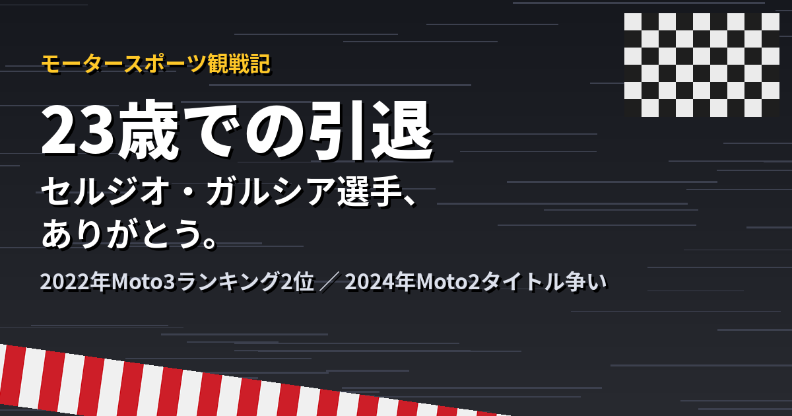
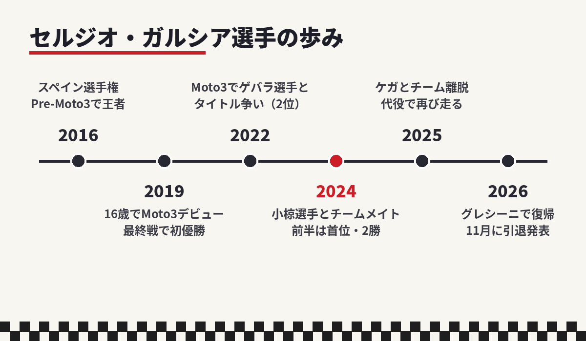
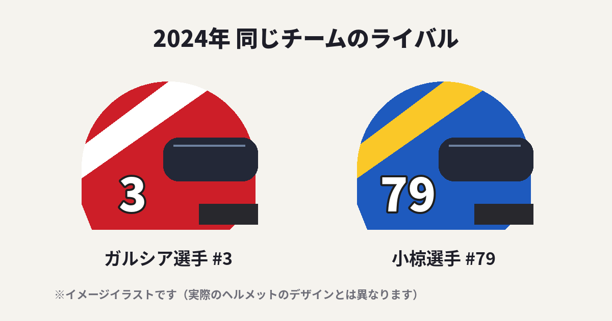

# まだ23歳。セルジオ・ガルシア選手の引退に、ちょっとびっくりしています

今年で引退するライダーということでね、セルジオ・ガルシア選手の引退をXで見かけました。

<!-- ここにガルシア選手本人の引退発表のX投稿を埋め込み（URLを貼るだけでOK） -->

## この記事の概要

- Moto2のセルジオ・ガルシア選手が、**23歳**で引退を発表
- 2024年は小椋藍選手と**同じチーム**でタイトル争い
- 私は2024年の茂木で、金曜日に転倒する姿を見ていました
- タイトルを逃してからの2年間と、今回の引退について思うこと

## まだ23歳なんですよ

ガルシア選手といえば、2年前にMoto2で日本の小椋藍選手とタイトル争いをしていた選手です。

その前はMoto3で、イサン・ゲバラ選手ともタイトル争いをしていました。

去年はちょっとスーパーバイクを走ったり、Moto2にスポットで出たりしていて、今年からグレシーニのチームでMoto2にフル参戦。

「ああ、復活したんだな」とお見かけはしていたんですけども、やっぱりなかなか上位には食い込めなくて、それで引退ということです。

ただ、驚いたのは年齢ですよね。まだ23歳なんですよ。

もっとベテランかと思っていたので、「そんなに若かったんだ」と、ちょっとびっくりしています。

## 引退の理由は肩のケガ

記事を読んでみると、2026年のオーストラリアGPで肩をケガして、シーズンを最後まで走れなくなったそうです。

本当は地元スペイン・バレンシアの最終戦で、ファンの前で走ってお別れしたかったと。それが叶わなかったのは、本人も悔しかったと思います。

成績は、Moto3で4シーズン、Moto2で4シーズン走って、**通算9勝、表彰台25回、ポールポジション3回**。

小さいころからバイクに触れて、16歳で世界選手権にデビューして、その年の最終戦でいきなり優勝しているんですね。

才能のある選手だったんだなと、あらためて思います。

## 小椋選手とのタイトル争い、同じチームだったんですよね

私の中でいちばん印象に残っているのは、やっぱり2024年のMoto2です。

この年、ガルシア選手と小椋選手は同じ**MTヘルメッツ–MSi**のチームで、同じボスコスクーロのバイクに乗っていました。チームメイト同士のタイトル争いだったんですよね。

シーズン前半はガルシア選手が強くて、フランスGP（ルマン）でも勝って、ランキングのトップを走っていました。

カタルーニャでは小椋選手が優勝、ガルシア選手が2位で、チームのワンツーなんてレースもありました。

それが後半になると、9月のサンマリノGPで小椋選手が勝ってランキングがひっくり返ります。

そこからガルシア選手はなかなか調子が戻らず、後半の10レースでトップ10に入れたのは2回だけだったそうです。

本人は後になって、チームが用意した新しいフレームにうまく合わせきれなかったことや、終盤はチームとの関係もかなり悪くなっていたことを話しています。

当時は「メンタル的に参っているんじゃないか」という声もあったようですが、本人は「うつではない」とはっきり否定していました。

## 茂木の金曜日、S字での転倒

その2024年の日本GP、私たちは茂木に見に行きました。

上の方のキャンプエリアで準備をしながら、金曜日のフリー走行を見ていたんですけど、そのとき、S字のところでガルシア選手が転倒するのを見かけたんです。

大きな転倒ではなかったんですけど、「あんまり調子良くないのかな」と思ったのを覚えています。

まあ金曜日ですからね、ぶっつけ本番みたいなところもあるし、そのときはそこまで気にしていませんでした。

<!-- ここに茂木で撮った自分の写真があれば入れる -->

日曜日のMoto2の決勝は、雨で赤旗が出て、12周に短縮されての再スタート。

スリックタイヤに賭けた選手が上位に来て、マヌエル・ゴンザレス選手が初優勝、小椋選手が2位でした。

実はね、私この日のゴンザレス選手は、ヤマハのVR46マスターキャンプの黄色いバイクで勝ったんだとずっと思い込んでいたんですよ。

今回調べてみたら、この年はグレシーニのバイクで、黄色いヤマハに乗っていたのはその前の年、2023年でした。記憶って、いつの間にか混ざっちゃうものですね。

で、ガルシア選手はこのレース14位。

小椋選手はこの時点でランキング2位以下に60点の差をつけていて、ガルシア選手はもう大きく遅れを取っていました。

まだランキングの上の方にはいたんですけど、あの金曜日の転倒も、今思えば苦しい時期の中のひとつだったのかなと思います。

結局、タイトルは小椋選手。ガルシア選手はランキング4位でシーズンを終えました。

## 行方不明のようだった2025年

タイトル争いに敗れた次の2025年は、さらに大変だったみたいです。

開幕前にケガをして序盤のレースを欠場、6月にはチームとの契約が途中で終わってしまいます。一時は乗るバイクがない、という状態でした。

私も「あれ、ガルシア選手どこ行ったんだろう」と思っていた時期です。

それでも8月にはケガをした選手の代わりにMoto2のハンガリーGPに出て、ホンダからスーパーバイク世界選手権にも代役で出場。

シーズン最後の2戦はグレシーニから走って、そして2026年、同じグレシーニでMoto2フル参戦に戻ってきました。

## おわりに

ここからは想像の域にはなるんですけど、タイトル争いに敗れてからの2年間は、バイクのことだけじゃなくて、メンタル面でも相当追い詰められていたんじゃないかなと思います。

チームメイトがチャンピオンになって、自分はチームを離れることになって、それでもまた別のチームで走り続ける。なかなかできることじゃないですよね。

やっぱりアスリートの勝負の世界は厳しいです。才能があっても、ケガやフィジカル面の影響で思うように走れなくなることもある。

私も20代のころはバイクのレースをやっていたので、ほんの少しですけど、その厳しさは分かるつもりです。

モーターサイクルファンとして気にかけていたライダーだったので、本当にびっくりしましたけど、本人は「心は満たされている」と前向きな言葉で発表を締めくくっていました。

次の道でも頑張ってほしいなと思います。

ガルシア選手、熱い走りをありがとうございました。

---

#### 参考にした情報

- [Sergio García プロフィール（MotoGP公式）](https://www.motogp.com/en/riders/sergio-garcia/6251aee5-6e36-455c-8b43-e6fd1753fd8d)
- [2024 Japanese Moto2 Grand Prix - Race Results（Crash.net）](https://www.crash.net/moto2/results/1057394/1/2024-japanese-moto2-grand-prix-race-results)
